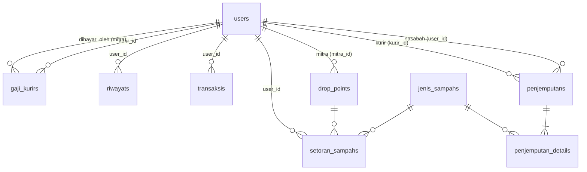

# Database REGREEN – Bank Sampah

| File | Isi |
|---|---|
| `schema.sql` | Struktur tabel, relasi, dan view (MySQL/MariaDB) |
| `seed.sql` | Data demo: 1 admin, 1 mitra, 3 kurir, 2 nasabah, jenis sampah, drop point, contoh transaksi |

## Cara pakai
```bash
mysql -u root -p < schema.sql
mysql -u root -p < seed.sql
```
Lalu di `backend/.env` set `DB_CONNECTION=mysql`, `DB_DATABASE=regreen_banksampah`.
Jika memakai SQL ini, **jangan** jalankan `php artisan migrate` pada database yang sama.
Jika memilih migrasi Laravel, cukup `php artisan migrate --seed` dan folder ini jadi dokumentasi.

## Peran (`users.role`)
| Role | Fungsi |
|---|---|
| `nasabah` | Menyetor/mengajukan penjemputan, punya saldo & poin hijau, menilai kurir, tarik saldo |
| `mitra` | Pemilik bank sampah: terima permintaan, tugaskan kurir, bayar nasabah, bayar gaji kurir |
| `kurir` | Menjemput & menimbang sampah (kolom `kendaraan`, `plat_nomor`) |
| `admin` | Atur harga sampah, setujui/tolak penarikan, kelola user (maks. 1 akun, aturan di model User) |

## ERD


## Alur status penjemputan
`DIAJUKAN` → `DITERIMA` (mitra) → `DALAM PROSES` (kurir ditugaskan) → `DIJEMPUT` (ditimbang) → `SELESAI` (dibayar) | `DIBATALKAN`

## Catatan
`drop_points.mitra_id` adalah tambahan baru (belum ada di migrasi backend) agar tiap bank sampah punya pemilik.
Jika dipakai, tambahkan migrasinya di Laravel dan `mitra_id` di model `DropPoint`.
